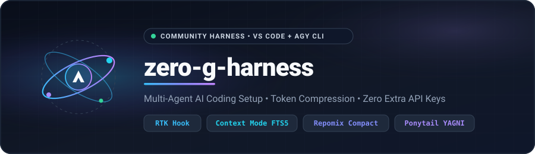
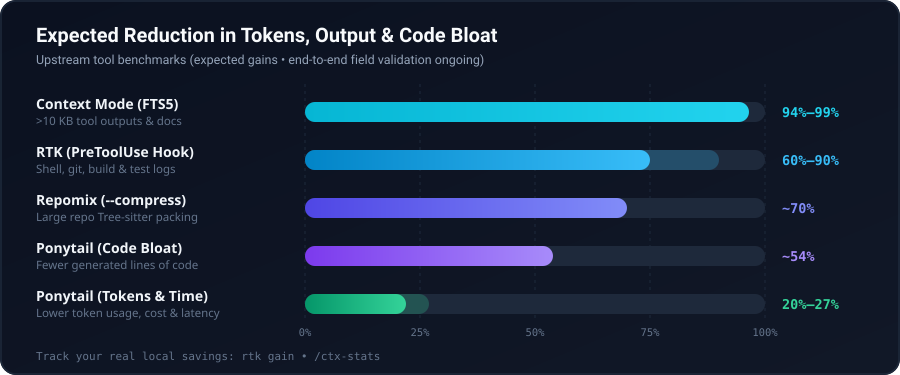
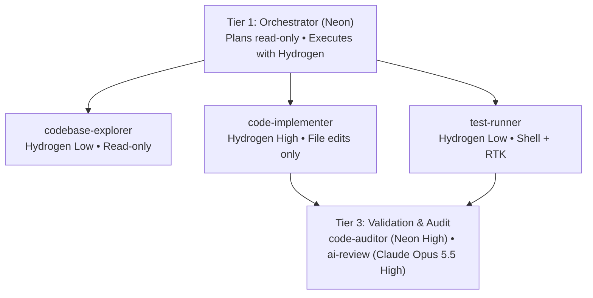

<p align="center">
  
</p>

<p align="center">
  
  
  
  
</p>

<p align="center">
  A lightweight, dotfiles-style multi-agent coding harness for <strong>Google Antigravity</strong> (unified across <strong>VS Code</strong> and <strong><code>agy</code> CLI</strong>), built for the <strong>Google AI Pro</strong> plan with zero external API keys.
</p>

---

## Why This Harness?

Long AI coding sessions quickly burn through context windows and 5-hour/weekly quota limits due to verbose shell logs, full-file reads, over-engineered code, and repeated context compaction (~135k tokens in Antigravity).

This setup combines **context compression**, **isolated subagents**, and **anti-overengineering rules** into a single Git-tracked dotfiles harness:

| Pillar | What It Solves |
| :--- | :--- |
| **Shell Compression (`RTK`)** | Transparently filters noisy `git`, build, and test output before it enters the prompt. |
| **On-Demand Indexing (`Context Mode` + `Repomix`)** | Keeps large logs, PDFs (SQLite FTS5), and huge repos (Tree-sitter) out of chat history. |
| **Anti-Overengineering (`GEMINI.md` + `Ponytail`)** | Cuts unnecessary boilerplate and abstractions while preserving security & trust-boundary checks. |
| **Context Isolation & Quota Routing** | Pairs `Orchestrator (Neon)` + `Gemini 4 Hydrogen` for dev, `code-auditor` for fresh-eyes audits, and `ai-review` (`claude-opus-5-5-high`) on the separate Claude/GPT quota pool. |
| **Zero-Token Slash Skills** | Slash-command-only skills (`disable-model-invocation: true`) consume **0 tokens** in the system prompt until called. |
| **Dotfiles Symlinks** | Keeps VS Code, `agy` CLI, and your Git repo automatically in sync with zero manual copying. |

---

## Expected Performance & Token Savings

<p align="center">
  
</p>

> [!NOTE]
> These numbers represent **expected gains** from each upstream tool's published benchmarks. Combined end-to-end savings for this full harness have **not yet been formally benchmarked in the field** and will vary by project size and workflow. Measure your real local savings anytime with `rtk gain` and `/ctx-stats`.

| Layer / Component | Expected Impact | Basis |
| :--- | :--- | :--- |
| **Context Mode (`SQLite FTS5`)** | **94%–99%** smaller responses on >10 KB tool outputs & docs | `mksglu/context-mode` benchmarks |
| **RTK (`PreToolUse` hook)** | **60%–90%** smaller shell outputs (fewer tokens & slower quota burn) | `rtk-ai/rtk` benchmarks |
| **Repomix (`--compress`)** | **~70%** fewer tokens when mapping large repos via Tree-sitter | `yamadashy/repomix` benchmarks |
| **Ponytail rules** | **~54%** fewer LoC, **~22%** fewer tokens, **~20%** lower cost, **~27%** faster wall-time | `DietrichGebert/ponytail` benchmarks |

---

## Architecture at a Glance



### What's Included
- **4 custom subagents** (`config/agents/`): `codebase-explorer`, `code-implementer`, `test-runner`, `code-auditor`.
- **Global rules & template**: `config/GEMINI.md` + `config/templates/AGENTS.md.template`.
- **MCP config** (`config/mcp_config.json`): `context-mode`, `repomix`, `gemini-api-docs`.
- **3 CLI helpers** (`bin/`): `ai-init` (repo scaffolding), `ai-review` (adversarial diff review on Claude/GPT pool), `ai-worktree` (parallel Git worktrees).
- **Optional modules** (`config/optional/`): `cpp-embedded-gem5.md` rule and `academic-tutor` skill.

Deep dive: [GUIDE.md](./GUIDE.md) • [STRUCTURE.md](./STRUCTURE.md)

---

## Quick Start

**Prerequisites:** Linux (tested on Pop!\_OS 24.04), [Google Antigravity](https://antigravity.google) (VS Code extension and/or `agy` CLI), Node.js / `npm`.

```bash
git clone https://github.com/vincenzopioaltieri/zero-g-harness.git
cd zero-g-harness

# Full setup (symlinks + upstream tools & skills)
./install.sh

# Include optional embedded / university modules
./install.sh --with-optional

# Symlinks only (if upstream tools are already installed)
./install.sh --links-only --with-optional
```

Then select **`Orchestrator (Neon)`** in VS Code (or `/model` in `agy`) and reload (`Developer: Reload Window` in VS Code / `/skills reload` in `agy`).

### Maintenance & Uninstall

```bash
./install.sh --update      # Update upstream MCP servers & git plugins
./install.sh --uninstall   # Detach symlinks into standalone copies
```

---

## Credits & Licenses

This repository only contains original configuration files, custom subagents, and shell wrappers (MIT License). Third-party tools and skills are installed directly from their official upstream repositories during setup:

- [RTK (Rust Token Killer)](https://github.com/rtk-ai/rtk) — Apache-2.0 / BUSL-1.1
- [Context Mode](https://github.com/mksglu/context-mode) — Elastic License 2.0 (ELv2)
- [Repomix](https://github.com/yamadashy/repomix) — MIT License
- [Google Gemini Skills](https://github.com/google-gemini/gemini-skills) — Apache-2.0 License
- [Matt Pocock Skills](https://github.com/mattpocock/skills) — MIT License
- [Ponytail](https://github.com/DietrichGebert/ponytail) — MIT License

*Disclaimer: This is an independent community configuration and is not affiliated with or endorsed by Google, DeepMind, or Anthropic.*
